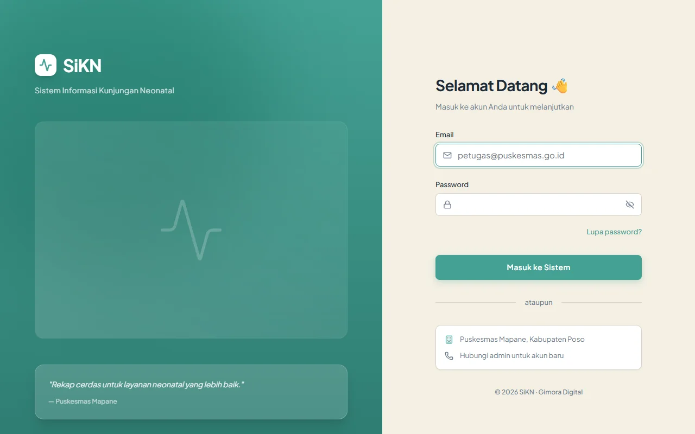

# SiKN Puskesmas Mapane

> [!NOTE]
> **Live System:** [`https://siknpuskesmas.gimmhost.my.id/`](https://siknpuskesmas.gimmhost.my.id/) — Sistem Informasi Kunjungan Neonatal untuk **Puskesmas Mapane, Kabupaten Poso**.



### Modul & Alur Kerja

| Fitur | Rute / Controller | Keterangan |
| :--- | :--- | :--- |
| **Dashboard & Rekap Tahunan** | `/dashboard`, `/rekap/yearly` | Ringkasan analitik layanan neonatal & grafik tren tahunan |
| **Smart Multi-Sheet Import** | `ImportController` | Pratinjau & pilih sheet Excel (`.xlsx`) tunggal maupun batch |
| **Ekspor Laporan Multi-Format** | `/print/preview` | Ekspor langsung ke **XLSX**, **CSV**, **PDF**, dan pratinjau cetak |
| **Manajemen Akun & Backup** | `/backup` | Manajemen petugas berbasis peran serta cadangan/pulihkan database |

### Tech Stack & Setup Lokal

**Stack:** Laravel 12 · Vue 3 · Inertia.js · Tailwind CSS · MySQL / SQLite

```bash
composer install && npm install && cp .env.example .env
php artisan key:generate && php artisan migrate --seed
php artisan serve & npm run dev
```
